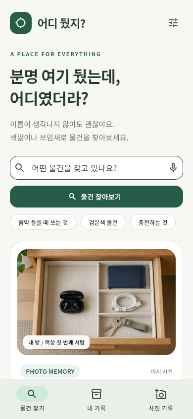
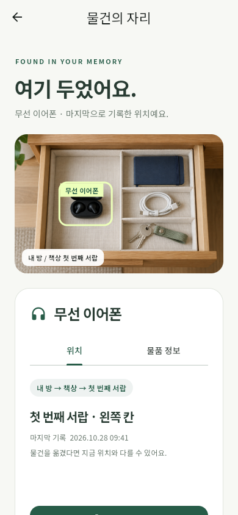
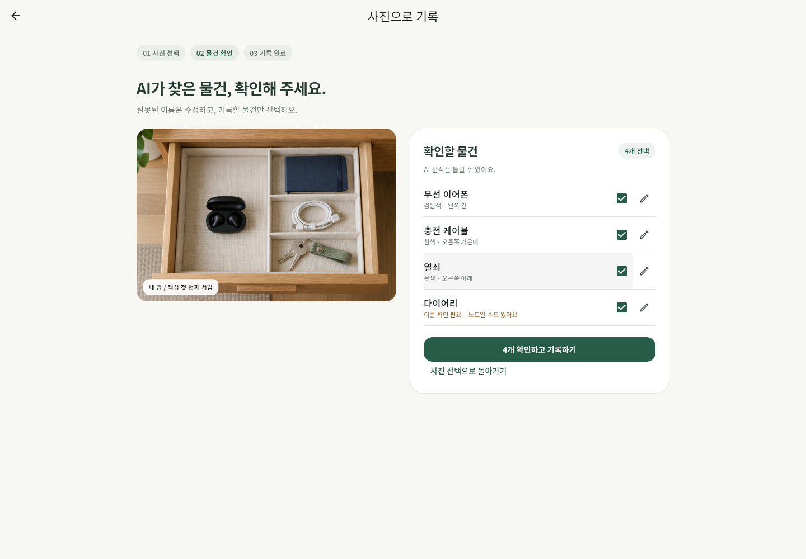
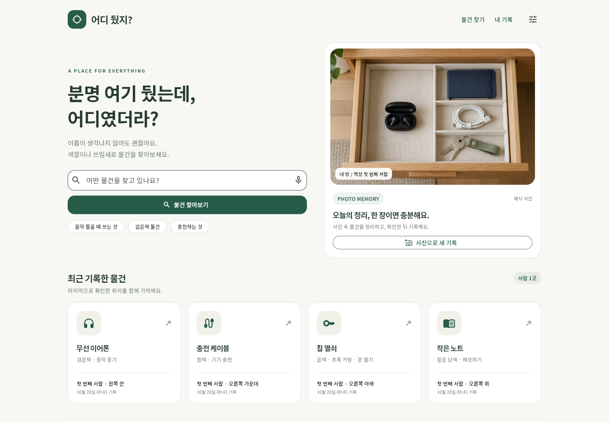

# 어디 뒀지? v2

## 앱 소개
### 앱 이름
어디 뒀지?
### 부제
사진으로 기록하고 말로 찾는 AI 물건 찾기 도우미
### 카테고리
생산성
### 대상 사용자 / 사용 상황
물건을 어디 두었는지 자주 잊어버리는 사람. 가상 퍼소나는 작은 방에서 공부하는 대학생이다. 외출 직전 이어폰·열쇠를 찾거나, 책상을 정리하면서 위치를 기록할 때 사용한다. 휴대폰과 넓은 화면을 지원한다.
### 스크린샷
| 현행 스토어 | v2 찾기 | v2 위치 | v2 확인 | v2 넓은 화면 |
|---|---|---|---|---|
|  |  |  |  |  |

현행 분석은 [익명 리뷰와 별점 분포](docs/현행분석.md), 비교용 대안은 [셀프 논증](docs/셀프논증.md). 대안 와이어프레임을 Itemtopia 실제 화면으로 표시하지 않는다.
### 설명
1. 책상·서랍 사진으로 물건과 위치를 기록하는 UI 프로토타입이다.
2. AI 목록은 사용자가 확인한다. 정확한 이름 대신 색깔·용도를 표현해 후보를 찾는다.
3. 후보와 사진·마지막 기록 시각을 함께 보며 물건을 찾는다. Itemtopia 리뷰에서 나타난 진입/입력 부담과 공간 재발견 가치를 근거로 삼았다.
### 새로운 기능
| P번호 | 변화(화면·요소) | 근거 |
|---|---|---|
| P05 | D-3/D-4 AI 후보 확인·수정 | 잘못된 이름을 확정하기 전 검토, R2/R3 |
| P06 | A-1/A-2 특징 검색·복수 후보 | 이름 회상 부담 감소, R4 |
| P01 | B-4 마지막 기록 시각 | 사진이 실시간 위치라는 오해 방지 |
### 평가 및 리뷰
현행 Itemtopia 미국 App Store **4.5/5 · 평가 169개**(2026-10-28). 리뷰와 평가 수를 구분한다. 대표 익명 리뷰 R2: “Now it is lagging to open” — ★2 · 2026-06-18(KST). [공식 스토어](https://apps.apple.com/us/app/itemtopia-inventory/id952405279?see-all=reviews). 세부 근거는 `docs/현행분석.md`.

## 작성자 · 제출 정보
| 항목 | 내용 |
|---|---|
| 현행 앱 | [Itemtopia](https://apps.apple.com/kr/app/id952405279) |
| v2 한 문장 | 이름이 기억나지 않아도 사진과 특징으로 마지막 기록 위치를 찾는다. |
| 작성자 | JIN ZHIXU (1인 1팀) |
| 데모 | [실제 UI 조작 영상 약 1분](docs/영상/demo_1min.mp4) |
| AI 사용 | [prompt-log](docs/prompt-log.md), [셀프 논증](docs/셀프논증.md), AGENTS.md |

## 빠른 실행 (Windows)
버튼별 사용 순서는 [실행 안내](실행안내.md)를 참고한다.

**Start-Demo.cmd 더블클릭** → 필요한 의존성 설치·웹 빌드 → 로컬 json-server + 웹 서버 → 브라우저가 열린다. Node.js와 Flutter가 PATH에 있어야 한다. 저장소에는 소스와 필요한 자료만 포함하며, 첫 실행 시 설치와 빌드에 시간이 걸린다. 첫 설치/빌드는 인터넷이 필요하며, 이후 폰트·사진·렌더러는 로컬 제공된다.

- 앱: http://localhost:8080
- 데이터: http://localhost:3000/items
- Windows 스크립트 실행 정책 때문에 실행이 안 되면 아래 표준 명령을 사용한다.
- 자동 실행 서버는 창을 닫아도 유지된다. 직접 실행한 터미널에서는 Ctrl+C로 종료한다.

## 표준 실행 (다른 컴퓨터 / clone 테스트)
Flutter stable(Dart >=3.10), Node.js 18 이상 및 npm을 준비한다.

터미널 1:
```sh
cd mock_server
npm ci
npm start
```
터미널 2 (프로젝트 루트):
```sh
flutter pub get
flutter run -d chrome
```
정적 웹 빌드로 실행:
```sh
flutter build web --no-web-resources-cdn
node scripts/serve-web.cjs
```
웹 기본 API는 localhost:3000, Android 에뮬레이터는 10.0.2.2:3000. 실기기는 `flutter run --dart-define=API_BASE=http://PC_IP:3000`. Android 실행은 기기 검증하지 않았다.

## 1분 데모 순서
1. 마이크 아이콘 → 예시 문장 → 이어폰 후보.
2. 후보 클릭 → 사진 위치 → 물품 정보 탭 → 찾았어요 → 홈.
3. 사진으로 새 기록 → 분석 → 다이어리를 작은 노트로 수정 → 확인하고 기록.
4. 홈 오른쪽 조절 아이콘 → 로딩/오류/빈 기록 → 정상.
5. 창을 좁혀 모바일 레이아웃 확인.

**검색은 고정 예시**: 음악/이어폰→이어폰, 검은→이어폰+짙은 노트(모호한 후보), 충전/케이블→케이블, 열쇠→열쇠. 빈 입력은 전체, 나머지는 빈 결과. 실제 의미 검색 알고리즘이 아니다. 음성은 마이크를 켜지 않으며 사진은 생성된 예시를 사용한다. 저장 완료는 화면만 바뀐다.

## 상태 시연 / 검증
홈 조절 아이콘에서 상태를 즉시 바꾼다. 정상으로 돌아오면 실제 GET 데이터를 표시한다. 오류의 재시도는 GET을 다시 실행한다. 서버를 끄면 실제 연결 실패도 확인할 수 있다.
```sh
flutter run -d chrome --dart-define=DEMO_STATE=loading
flutter run -d chrome --dart-define=DEMO_STATE=error
flutter run -d chrome --dart-define=DEMO_STATE=empty
flutter analyze
flutter test
```
DEMO_STATE=error/empty는 컴파일 시 고정하므로 정상으로 바꾸려면 define 없이 다시 실행한다. 일반 빌드의 데모 메뉴는 즉시 복귀 가능하다.

## 구조
- lib/main.dart: 테마·로컬 한글 폰트.
- lib/api.dart: 모든 네트워크 요청(GET만), 주소·시연 상태.
- lib/models.dart, lib/widgets.dart: 데이터·공통 상태·사진 컴포넌트.
- lib/screens/: A 검색, B 상세+탭, C 완료 시트, D 사진·검토·완료.
- mock_server/db.json: 4개 예시 물건.
- docs/: [디자인 가이드](docs/디자인가이드.md), [기획 상세](docs/기획상세.md), [현행 분석](docs/현행분석.md), [원칙 카드](docs/원칙카드.md), [자가평가](docs/자가평가.md).
- scripts/browser-qa.cjs: Playwright 조작·캡처·원본 영상 생성(개발 검증용, 앱 실행에 불필요).

## 출처
수업 템플릿: https://github.com/xide-projext/mid-project-template · 커밋 3a2d643ed1ff23d378995e5902d42f9edec74fe1. AGENTS, GET 경계·API_BASE·DEMO_STATE 방식, A/B/C 역할, docs 형식을 기반으로 개작했다. 플랫폼은 설치된 Flutter로 생성했다. 사진 검토 D를 설계에 추가했다.

assets/drawer.png는 내장 imagegen 제작. Noto Sans KR는 Google Fonts OFL 폰트이며 라이선스는 assets/fonts/OFL.txt. 서버 버전은 수업 템플릿과 동일한 json-server 0.17.4.
