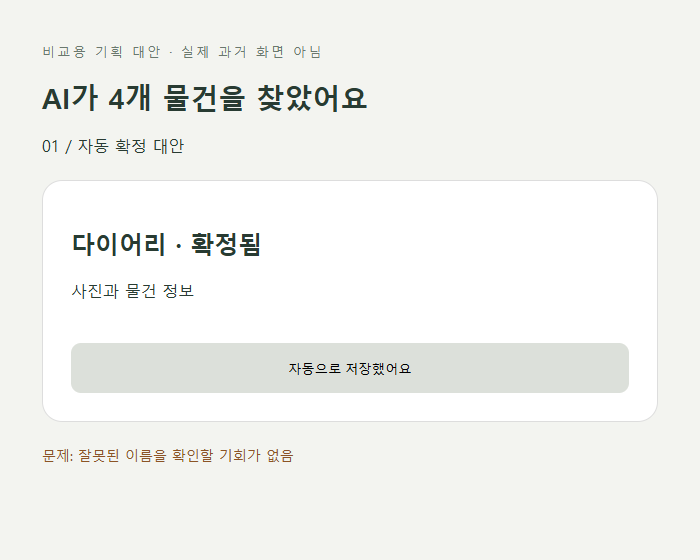
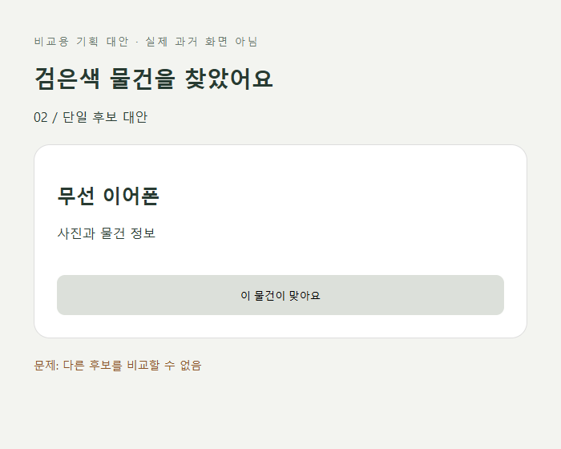
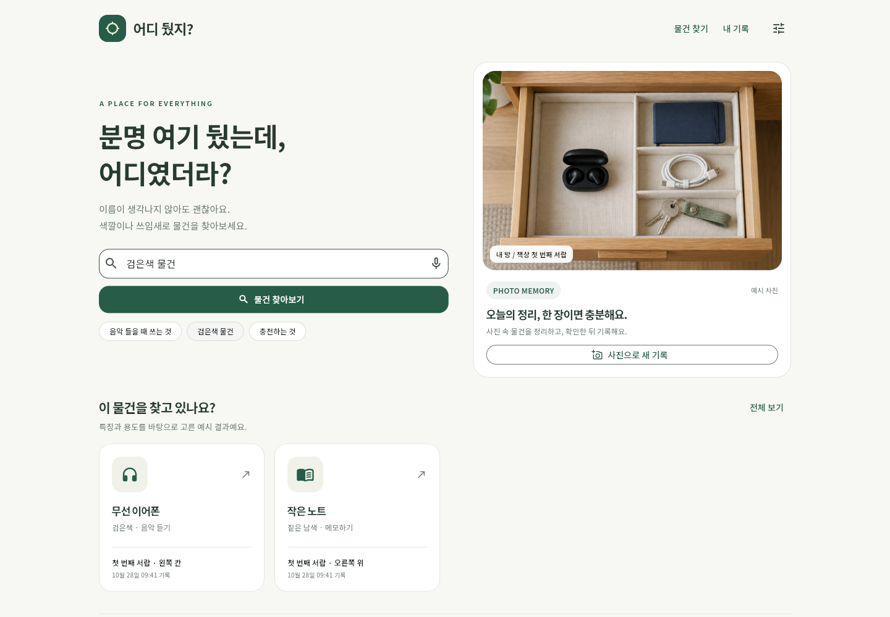
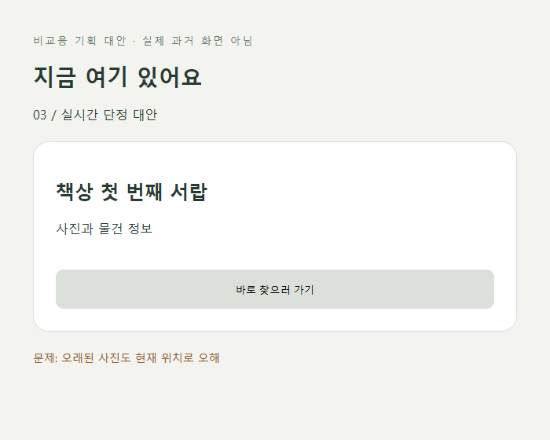
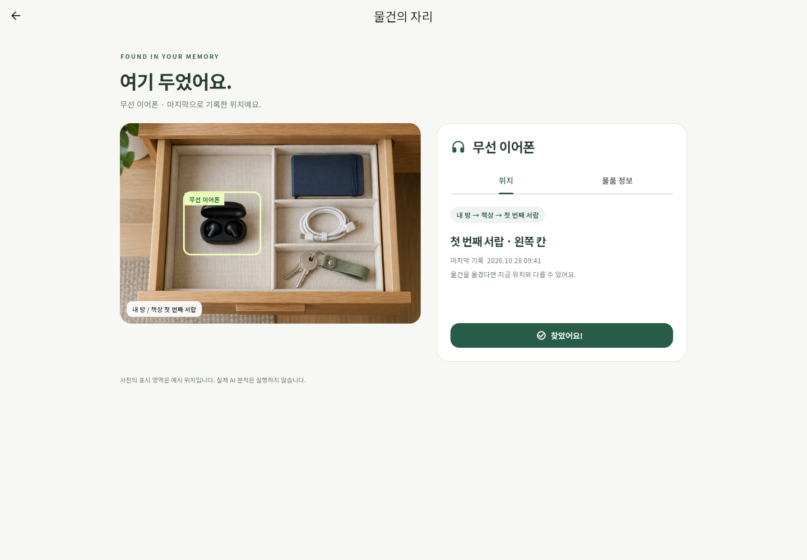

# 셀프 논증 기록

확인 단계, 복수 후보, 마지막 기록 시각을 중심으로 설계를 검토했다. 세 결정은 작성자가 확인했으며, 아래 재반론과 설계 이유는 AI의 도움을 받아 정리한 초안이다.

‘전’ 이미지는 **비교용 기획 대안 와이어프레임**, ‘후’ 이미지는 구현 화면이다. 이전 버전의 실행 화면을 뜻하지 않는다. 기획 확정 시점의 `v1-plan` 태그는 남기지 않아, 대안 이미지와 요소 번호로 비교한다.

| 쟁점 | 설계 주장 | AI 반론 | 재반론·수정 이유(초안) | 결론 | 근거 | 전 / 후 |
|---|---|---|---|---|---|---|
| 1. D-3 사용자 확인 | AI가 목록을 만든 뒤 사용자가 확인한다 | 모든 항목을 검토시키면 사진 기록의 속도 이점이 줄어든다 | 명확한 항목은 기본 선택한다. 불확실한 ‘다이어리’만 확인 필요로 강조해 점검 비용을 낮춘다. 빠른 자동 확정보다 잘못된 이름이 검색에 남지 않는 편이 목적에 맞다 | **수정 후 유지** | P05/P07, R2·R3, L3 | i1_before.png / review.png |
| 2. A-4 복수 후보 | 여러 후보를 사용자가 고르게 한다 | 후보가 많으면 선택 부담이 생긴다. 하나만 보여 주면 빠르다 | 색만으로는 노트와 이어폰을 구분하기 어렵다. 후보의 이름·색·용도·위치를 함께 보여 스스로 좁히게 한다. 실제 AI 순위 정확도를 주장하지 않는다 | **유지** | P06/P03, R4, L3·L4 | i2_before.png / multi_result.png |
| 3. B-4 위치 표현 | 마지막 기록 시각을 표시한다 | ‘지금 위치’라고 쓰는 편이 직관적이며 날짜는 잡음이 될 수 있다 | 사진 이후 물건이 이동했을 수 있다. 짧은 시각과 한 문장 안내는 잘못된 확신을 줄이는 데 필요하다 | **유지**, 실시간 단정 표현 **폐기** | P01/P02, L3·L4 | i3_before.png / detail_wide.png |

## 전·후 비교
### 1. 자동 확정 대안 → 사용자 확인

### 2. 단일 후보 대안 → 복수 후보

### 3. 현재 위치 단정 대안 → 마지막 기록 시각

## 남은 검증
실제 물건 사진과 여러 사용자를 대상으로 오인식 수정 부담·검색 성공률·기록 유지율을 검증해야 한다. 이번 제출물은 UI 프로토타입이며, 이 검증을 수행했다고 주장하지 않는다. 원칙 카드·prompt-log·코드의 P번호를 함께 확인한다.
