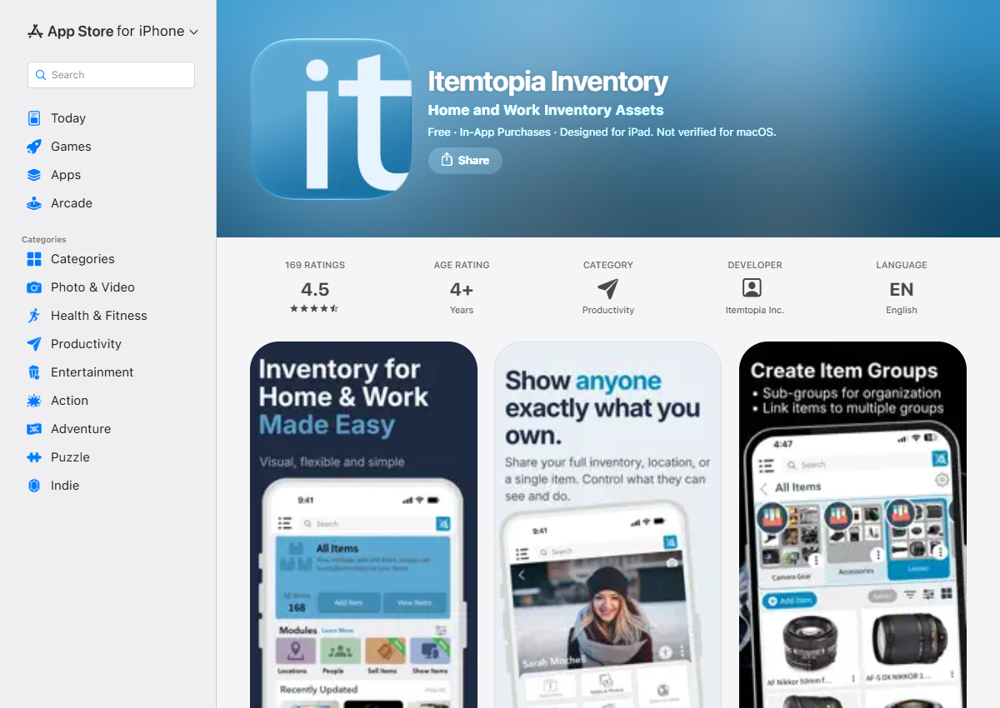

# 현행 유사 앱 분석

대상: **Itemtopia Inventory**. 사용자 지정 한국 링크: https://apps.apple.com/kr/app/id952405279
분석 가능한 미국 스토어의 리뷰·평점으로 지역을 통일했다. 한국 스토어와 수치가 같다고 주장하지 않는다.

- 확인일: 2026-10-28 (KST).
- 공식 출처: https://apps.apple.com/us/app/itemtopia-inventory/id952405279?see-all=reviews
- 리뷰 별점·날짜 보조 검증: https://itunes.apple.com/us/rss/customerreviews/id=952405279/sortBy=mostRecent/json
- 수집 방법: 스토어 공개 페이지의 평점 집계 및 Apple RSS. 작성자 이름은 기록하지 않음.

## 별점 분포 (미국 App Store, 평가 169개)
평균 **4.5/5**, 평가 수 169. `ratingCounts`를 별 5→1 순서로 읽은 확인 시점 값이다. 리뷰 수와 별점 평가 수는 같지 않다. RSS 표본으로 전체 분포를 추정하지 않았다.

| 별점 | 평가 수 | 시각적 분포(대략) |
|---|---:|---|
| ★★★★★ | 128 | ██████████████████████████ |
| ★★★★ | 18 | ████ |
| ★★★ | 6 | █ |
| ★★ | 7 | █ |
| ★ | 10 | ██ |

## 익명 리뷰 근거
날짜는 Apple RSS 제공 타임스탬프의 KST 날짜다. 미국 스토어 표시일보다 하루 늦을 수 있다. 아래는 짧은 원문 인용 + 한국어 해석이다. 리뷰는 개인 경험이며 현재 모든 버전의 상태를 입증하지 않는다.

| ID | 날짜 · 별점 | 짧은 원문 | 해석 / 유형 | v2에서의 대응 |
|---|---|---|---|---|
| R1 | 2026-08-26 · ★1 | “Shouldn’t need to create an account” | 계정 요구가 진입 장벽이라는 의견 / 시작 마찰 | 과제 UI는 즉시 탐색. P08 |
| R2 | 2026-06-18 · ★2 | “Now it is lagging to open” | AI 추가 뒤 지연·중단을 경험했다는 의견 / 성능·신뢰 | 분석 중 상태, 사용자 확인. P01/P05 |
| R3 | 2026-01-10 · ★1 | “They would disappear” | 입력 필드 소실·겹침 경험 / 입력 안정성 | 적은 필드, 명확한 수정. P05/P08 |
| R4 | 2024-10-26 · ★5 | “did not know” | 여러 상자 속 물건 위치 확인에 유용 / 공간 재발견 | 장소·사진을 유지. P02/P06 |

## 잘된 점과 개선 방향
- R4: 소유 물건을 공간에 연결하는 모델은 현실의 정리 방식과 맞는다(P02). 위치 정보를 v2에서도 유지한다.
- 사진과 상세 정보 제공은 이름을 외우지 않고 대상을 확인하게 한다(P06). v2는 사진 위 표시로 이를 강조한다.
- 다목적 재고 관리는 강점이나, 일상 재발견 과업에는 입력 정보가 많아질 수 있다(설계 해석, 모든 사용자에게 불편하다는 주장 아님).
- R2는 ‘AI가 있으면 항상 UX가 좋아진다’는 가정을 반박한다. 정확도·속도 개선은 이 UI 과제에서 검증할 수 없으므로 시연을 실제 AI 성능으로 주장하지 않는다.

## 근거의 한계
사례 4개는 대표성 있는 통계 표본이 아니다. 사용성 실험을 수행하지 않았다. 앱 설치 후 직접 검사한 결과와 공개 리뷰 분석을 혼동하지 않는다. 스토어 화면의 실제 캡처와 v2 자체 설계를 별도로 표시한다.

## 현행 스토어 화면
아래는 공식 App Store 페이지 캡처(2026-10-28)이며 앱을 직접 설치·조작한 화면이 아니다. 평점과 소개 이미지를 확인할 수 있다.

